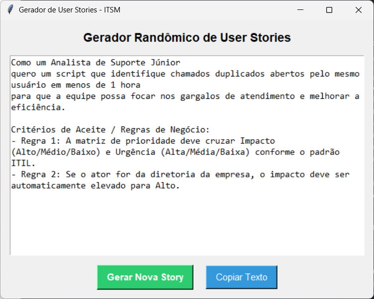

# gerador-user-stories-itsm



Criei este script em Python para ajudar na minha rotina de estudos de programação. O objetivo do app é bem simples: gerar histórias de usuário (User Stories) e critérios de aceite aleatórios para servir como "desafios" de código. 

A ideia é usar os requisitos gerados pela ferramenta para delimitar o escopo de pequenas features e treinar lógica de programação construindo scripts curtos, sem inventar coisas mirabolantes.

O projeto foi escrito em Python 3.15 e usa Tkinter para a interface gráfica. Também compilei o script para quem quiser rodar direto no Windows sem precisar configurar ambiente.

## Como usar

### Executável (.exe)
1. Vá na seção de **Releases** aqui do lado direito do repositório.
2. Baixe o arquivo `gerador.exe`.
3. É só dar dois cliques e rodar.

### Código-fonte
Se preferir rodar direto pelo terminal ou inspecionar o código, certifique-se de ter o Python instalado e execute:

```bash
python gerador.py
```

## O que foi praticado no código
* Construção de interface gráfica simples com a biblioteca nativa `tkinter`.
* Manipulação de arrays e matrizes para associar as regras de negócio corretas a cada ação sorteada.
* Sorteio dinâmico de componentes usando a biblioteca `random`.
* Integração com a área de transferência do sistema operacional para copiar o texto formatado.
* Empacotamento do script em um executável único e independente utilizando `pyinstaller`.
